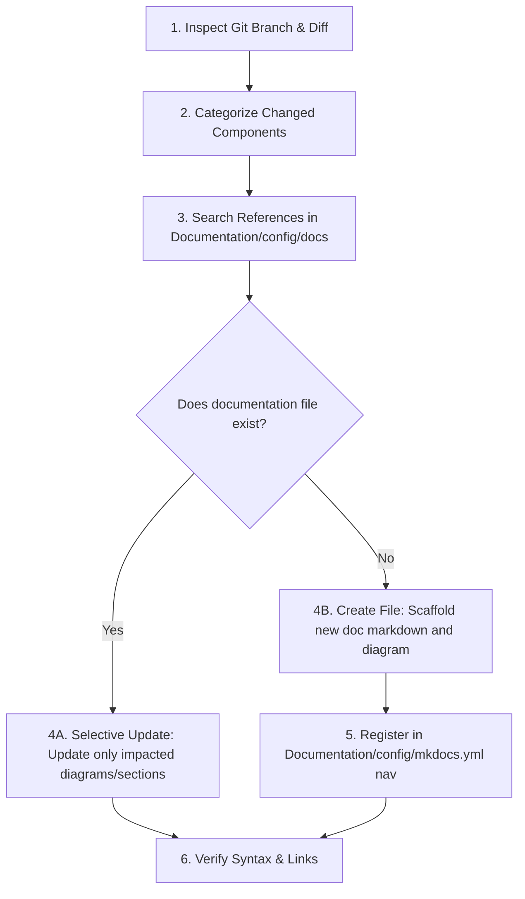

# Documentation Orchestrator & Master Index

## 1. Overview & Purpose

This skill serves as the **master entry point and protocol** for managing all documentation and diagrams in the project.

Whenever changes are made to the codebase (or when preparing commits/pull requests), the agent **must not** perform random or blanket documentation updates. Instead, the agent follows a systematic, diff-driven inspection of the current git branch, identifies the impacted components, finds their references in `Documentation/config/docs/`, updates only the affected diagrams, and automatically creates any missing documentation files.

---

## 2. Standard Branch-Inspection Workflow



### Step 1: Inspect Current Branch & Changes
Always run terminal commands to understand the exact scope of the working branch:
```bash
# Check current branch name
git branch --show-current

# Check modified, untracked, and staged files
git status --short

# View exact code diff against HEAD or base branch
git diff HEAD
# Or against base/main branch:
git diff main...HEAD --name-only
```

### Step 2: Categorize Changed Code Components
Inspect the diff and map every changed element to its corresponding diagram domain:

| Changed Component Type | Target Skill | Target Diagram Type |
| :--- | :--- | :--- |
| Backend Classes, Interfaces, Entities, Services, Repositories | [class-diagram.md](./mermaid/class-diagram.md) | Mermaid `classDiagram` |
| REST Endpoints, HTTP Controllers, Route Handlers | [sequence-diagram.md](./mermaid/sequence-diagram.md) | Mermaid `sequenceDiagram` |
| Background Workers, Queue Consumers, Cron Jobs | [sequence-diagram.md](./mermaid/sequence-diagram.md) | Mermaid `sequenceDiagram` |
| Database Migrations, Models, Tables, Columns, Relations | [diagram.md](./dbdiagram/diagram.md) | DBML / dbdiagram.io |
| Use Cases, User Journeys, Actor Permissions | [use-case-diagram.md](./mermaid/use-case-diagram.md) | Mermaid `flowchart LR` |
| Business Logic Trees, Decision Gates, Policy Flowcharts | [decision-flow-diagram.md](./mermaid/decision-flow-diagram.md) | Mermaid `flowchart TD` |

### Step 3: Search for Existing References in `Documentation/config/docs/`
Search `Documentation/config/docs/` using grep or file matching to find where the component is already documented:
```bash
# Search for mentions of the class, endpoint, or table name
grep -rn "UserEntity" Documentation/config/docs/
grep -rn "/api/v1/users" Documentation/config/docs/
grep -rn "Table users" Documentation/config/docs/
```

### Step 4: Selective Update vs. File Creation
- **Case A: Documentation file exists:**
  - Read the existing file.
  - Locate the relevant diagram block (` ```mermaid ` or ` ```dbml `).
  - Update **only** the elements directly affected by the branch's code diff (e.g., added attributes, changed methods, new error flows).
  - Do **not** overwrite or remove unrelated diagrams.
- **Case B: Documentation file DOES NOT exist:**
  - Create a new markdown file following the path conventions defined in Section 3.
  - Scaffold the file with standard title, module overview, and the newly generated diagram.
  - Register the new page in `Documentation/config/mkdocs.yml` under the `nav:` hierarchy.

---

## 3. Directory Layout & Conventions in `Documentation/config/docs/`

Always place new documentation in predictable domain-driven directories:

```text
Documentation/config/docs/
├── index.md                              # Home documentation page
├── business-rules/                       # Global business logic, full flowcharts & use cases
│   ├── index.md                          # Business rules landing page
│   ├── <feature>-use-cases.md            # Use case diagrams & actor interactions
│   └── <policy>-decision-flow.md         # Decision trees & validation gates
├── backend/
│   ├── architecture/                     # System architecture & high-level class diagrams
│   │   └── overview.md
│   └── domain/                           # Domain entities, models & services
│       └── <context-or-module>.md        # e.g., auth.md, billing.md
├── api/
│   └── endpoints/                        # HTTP endpoints & sequence diagrams
│       └── <resource>.md                 # e.g., users.md, webhooks.md
├── workers/                              # Background processors & queue sequence diagrams
│   └── <worker-name>.md                  # e.g., notification-worker.md
└── database/                             # Database schema docs & DBML
    ├── schema.dbml                       # Master DBML definition
    └── tables.md                         # Detailed relational data dictionary
```

---

## 4. Template for Creating New Documentation Files

When creating a new documentation file, use the following clean structure:

````markdown
# <Component or Feature Name>

## 1. Overview
Brief description of the component, its business purpose, and responsibility.

## 2. Architecture & Flow Diagram
<!-- Embed Mermaid or DBML diagram here -->
```mermaid
...
```

## 3. Specifications & Contracts
- **Endpoints / Methods**: Detailed contract and payload descriptions.
- **Error Handling**: Possible failure codes and exception cases.
- **Related Files**: Links to implementation source files in `Code/`.
````

---

## 5. Updating MkDocs Navigation (`mkdocs.yml`)

Whenever a new `.md` file is created inside `Documentation/config/docs/`, add it to the `nav` tree in `Documentation/config/mkdocs.yml`:

```yaml
nav:
  - Home: index.md
  - Backend:
      - Architecture: backend/architecture/overview.md
      - Domain Models: backend/domain/auth.md
  - API:
      - Endpoints: api/endpoints/users.md
  - Workers:
      - Notifications: workers/notification-worker.md
  - Database:
      - Schema & Tables: database/tables.md
```

---

## 6. Verification Checklist

Before completing documentation tasks, confirm:
- [ ] Checked `git diff` on the active branch to identify all affected components.
- [ ] Searched `Documentation/config/docs/` for existing references.
- [ ] Updated existing diagrams strictly where changes occurred.
- [ ] Created new documentation files for previously undocumented components.
- [ ] Verified `Documentation/config/mkdocs.yml` contains navigation entries for any new files.
- [ ] Verified all diagram blocks have valid Mermaid or DBML syntax without unescaped characters.
