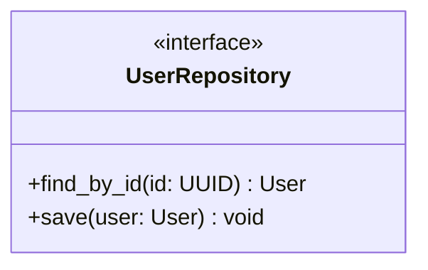
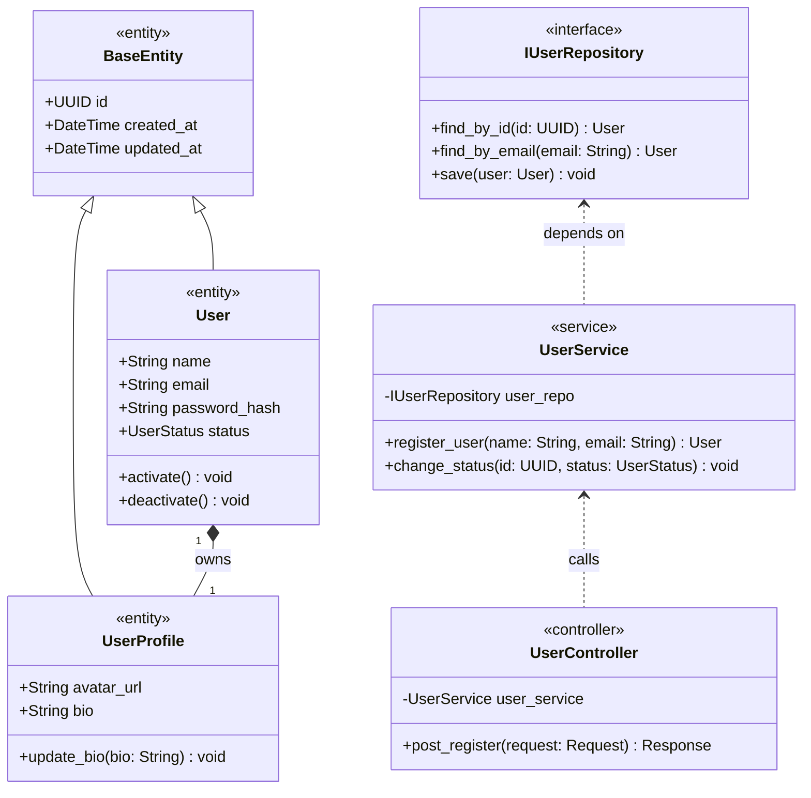

# Mermaid Class Diagram Skill

## 1. Overview & Purpose

Whenever backend code (classes, interfaces, entities, services, repositories, or controllers) is added, refactored, or identified, you must produce or update the corresponding Mermaid class diagram.

Class diagrams provide architectural clarity, illustrating static structure, property types, method contracts, and relationships between components.

## 2. Branch Inspection & Selective Update Protocol

Always orchestrate documentation changes through the master index at [documentation.md](../documentation.md):

1. **Inspect Branch Changes First**:
   Run `git status` and `git diff HEAD` (or compare against base branch) to identify which backend classes, interfaces, or domain entities were modified or added.
2. **Search Existing References**:
   Query `Documentation/config/docs/` for mentions of the modified class names (e.g., `grep -rn "ClassName" Documentation/config/docs/`).
3. **Selective Diagram Update**:
   - If the class diagram already exists, update **strictly the affected classes, attributes, methods, or relationships**. Do not disturb untouched components.
4. **Auto-Create Missing Documentation Files**:
   - If no documentation file exists for the changed module or domain, automatically create a new `.md` file under `Documentation/config/docs/backend/domain/<module>.md` or `Documentation/config/docs/backend/architecture/`.
   - Embed the new `classDiagram`.
   - Add the new page to `Documentation/config/mkdocs.yml` under the `nav:` hierarchy.

## 3. Storage & Location Conventions

- Store diagrams inside the relevant documentation module in `Documentation/config/docs/`:
  - Domain models & entities: `Documentation/config/docs/backend/domain/`
  - Architecture & layers: `Documentation/config/docs/backend/architecture/`
  - Service-specific components: Under the respective service documentation folder.
- Embed the diagram in Markdown using fenced code blocks with the `mermaid` language tag:
  ```markdown
  ```mermaid
  classDiagram
      ...
  ```
  ```

## 4. Syntax Standards & Rules

### 3.1 Class Definition & Stereotypes
Use standard stereotypes to indicate architectural roles:
- `<<interface>>` for contracts/interfaces
- `<<entity>>` for domain entities with identity
- `<<value_object>>` for immutable domain value objects
- `<<service>>` for application or domain services
- `<<repository>>` for data access contracts or implementations
- `<<controller>>` for API or RPC controllers



### 3.2 Member Visibility & Typing
Always specify visibility modifiers and explicit types:
- `+` Public
- `-` Private
- `#` Protected
- `~` Package / Internal

Format attributes as:
`[visibility][type] [name]` or `[visibility][name]: [type]`

Format methods as:
`[visibility][name]([param]: [type]) [return_type]`

### 3.3 Relationship Connectors
Use precise UML relationship arrows:

| Relationship | Syntax | Meaning |
| :--- | :---: | :--- |
| **Inheritance / Generalization** | `<|--` | Subclass inherits from superclass |
| **Realization / Implementation** | `..|>` | Class implements an interface |
| **Composition** | `*--` | Part cannot exist without the whole (lifecycle bound) |
| **Aggregation** | `o--` | Part can exist independently of the whole |
| **Association** | `-->` | Directed reference / navigation |
| **Dependency** | `..>` | Uses / receives as parameter / instantiates |

Multiplicities should be explicitly declared when meaningful:
`"1" *-- "0..*"` or `"1" --> "1"`

## 4. Complete Architecture Example



## 5. Best Practices & Constraints

1. **Bounded Scope**: Do not create a single monolithic diagram containing all classes in the entire backend. Divide diagrams by bounded context, layer, or feature.
2. **Naming Accuracy**: Ensure class names, field names, and method signatures strictly match the code implementation.
3. **MkDocs & Markdown Rendering Safety**:
   - Avoid HTML markup inside labels (e.g., do not use `<br>`, `<b>`).
   - Quote labels containing special symbols or punctuation: `class_id["Class Label (Details)"]`.
4. **Maintenance**: Whenever you alter a class signature, add a property, or modify an interface, immediately update the corresponding diagram.

## 6. Verification Checklist

- [ ] Diagram starts with `classDiagram` inside a fenced code block with `mermaid`.
- [ ] Stereotypes (`<<interface>>`, `<<entity>>`, etc.) are assigned where applicable.
- [ ] Attributes and methods include visibility prefixes (`+`, `-`, etc.) and types.
- [ ] Relationships reflect true architectural coupling (inheritance, composition, dependency).
- [ ] No unescaped special characters causing rendering syntax errors.
