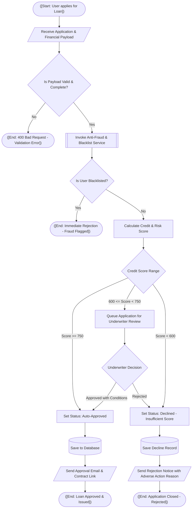

# Mermaid Decision Flow Diagram Skill

## 1. Overview & Purpose

Whenever complex business rules, conditional approval gates, fraud checks, KYC verification, calculation branching, or stateful decision trees are implemented or altered in code, you must produce or update the corresponding Mermaid decision flow diagram.

Decision flowcharts document deterministic logic pathways, condition evaluation, fallbacks, and terminal outcomes, making complex business policies easily verifiable by developers and business stakeholders alike.

---

## 2. Branch Inspection & Selective Update Protocol

Always orchestrate documentation changes through the master index at [documentation.md](../documentation.md):

1. **Inspect Branch Changes First**:
   Examine `git diff HEAD` (or compare against base branch) to identify new conditional statements, policy checkers, guard clauses, validation chains, or business rule services.
2. **Search Existing References**:
   Query `Documentation/config/docs/business-rules/` for mentions of the policy or rule name (e.g., `grep -rn "RiskAssessment" Documentation/config/docs/business-rules/`).
3. **Selective Diagram Update**:
   - If a decision flow already exists for that policy, update **strictly the modified decision diamonds, threshold checks, action boxes, or branch pathways**. Do not redraw unaffected logic.
4. **Auto-Create Missing Documentation Files**:
   - If no decision flow documentation exists for the rule, create a new `.md` file under `Documentation/config/docs/business-rules/<rule-or-policy>-decision-flow.md`.
   - Embed the new Mermaid decision flowchart.
   - Register the new page in `Documentation/config/mkdocs.yml` under `nav:`.

---

## 3. Storage & Location Conventions

- Store decision flow documentation in:
  `Documentation/config/docs/business-rules/<policy>-decision-flow.md` or `Documentation/config/docs/business-rules/`
- Embed the diagram in Markdown using fenced code blocks with the `mermaid` language tag:
  ```markdown
  ```mermaid
  flowchart TD
      ...
  ```
  ```

---

## 4. Syntax Standards & Node Types

Decision flows should prioritize clarity and unambiguous branch labels. Use the standard node shapes:

| Node Type | Mermaid Syntax | Standard Usage |
| :--- | :---: | :--- |
| **Start / Terminal State** | `([Start / State])` | Entry point or final terminal resolution |
| **Decision / Condition** | `{Is condition met?}` | Diamond evaluation; requires at least 2 labeled outgoing paths |
| **Action / Process** | `[Execute Task]` | Computation, data transformation, or function call |
| **Subprocess / External Call** | `[[External Service / API]]` | Delegation to another service or subsystem |
| **Database / Storage** | `[(Read/Write DB)]` | Persistent state storage |
| **Data Input / Output** | `[/Input or Output Data/]` | Receiving user input or emitting an external event |

### 4.1 Branch Labeling Rule
- Every outgoing edge from a Decision Diamond `{...}` **must** carry a clear edge label:
  ```text
  check_status{Is email verified?} -->|Yes| proceed[Process Order]
  check_status -->|No| send_link[Send Verification Email]
  ```

---

## 5. Complete Decision Flow Reference Example



---

## 6. Best Practices & Guidelines

1. **Direction**: Use `flowchart TD` (Top-Down) for vertical logic progression, or `flowchart LR` (Left-to-Right) when modeling multi-stage horizontal pipelines.
2. **Every Path Must Terminate**: Never leave dangling paths. Every conditional branch must either loop back to a retry point or terminate in a defined terminal state (`([End: ...])`).
3. **MkDocs Character Safety**:
   - Quote labels containing relational operators (`<`, `>`, `<=`, `>=`):
     `evaluate_score -->|"Score >= 750"| auto_approve`
   - Avoid unescaped special characters that could break parsing.

## 7. Verification Checklist

- [ ] Starts with `flowchart TD` (or `flowchart LR`).
- [ ] Every decision diamond `{...}` has at least two labeled branch outputs (`-->|Label|`).
- [ ] Terminal states use stadium syntax `([End: ...])`.
- [ ] All logical pathways terminate cleanly without loose ends.
- [ ] Quoted edge labels used where comparison operators or parentheses are present.
