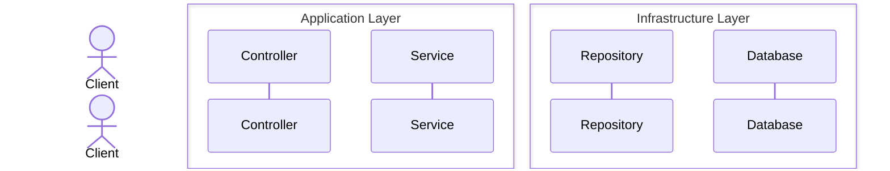
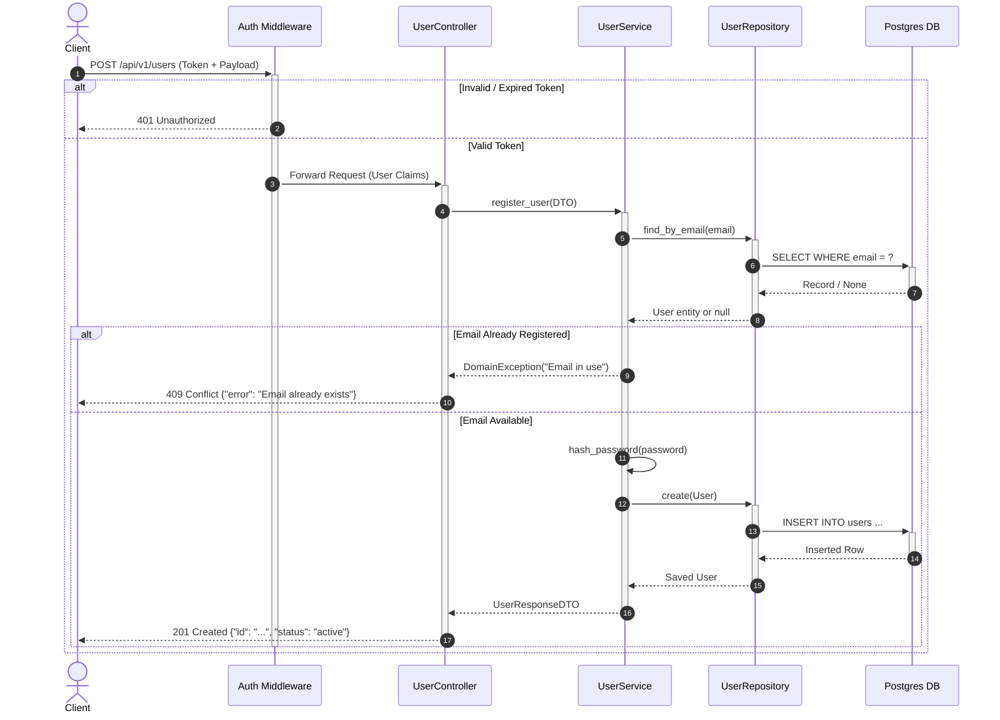

# Mermaid Sequence Diagram Skill

## 1. Overview & Purpose

Whenever a new HTTP/REST/RPC endpoint or background worker/queue consumer is created or modified, you must generate or update a Mermaid sequence diagram.

Sequence diagrams document the runtime behavior and message passing order across components, external services, caches, databases, and message brokers.

## 2. Branch Inspection & Selective Update Protocol

Always orchestrate documentation changes through the master index at [documentation.md](../documentation.md):

1. **Inspect Branch Changes First**:
   Run `git status` and `git diff HEAD` (or compare against base branch) to identify which HTTP routes, API endpoints, controllers, or background workers were modified or created.
2. **Search Existing References**:
   Query `Documentation/config/docs/` for mentions of the route path, controller name, or worker event (e.g., `grep -rn "/api/v1/resource" Documentation/config/docs/` or `grep -rn "EventWorker" Documentation/config/docs/`).
3. **Selective Diagram Update**:
   - If the sequence diagram already exists, update **strictly the affected message exchanges, activation lifetimes, error branches, or parameters**. Do not disturb unrelated flows.
4. **Auto-Create Missing Documentation Files**:
   - If no documentation file exists for the endpoint or worker, automatically create a new `.md` file under `Documentation/config/docs/api/endpoints/<resource>.md` or `Documentation/config/docs/workers/<worker-name>.md`.
   - Embed the new `sequenceDiagram` with full happy and error paths.
   - Add the new page to `Documentation/config/mkdocs.yml` under `nav:`.

## 3. Storage & Location Conventions

- Store diagrams inside the relevant documentation section in `Documentation/config/docs/`:
  - API Endpoints: `Documentation/config/docs/api/endpoints/` or alongside endpoint route specs.
  - Workers & Jobs: `Documentation/config/docs/workers/` or background processing architecture docs.
- Embed the diagram in Markdown using fenced code blocks with the `mermaid` language tag:
  ```markdown
  ```mermaid
  sequenceDiagram
      ...
  ```
  ```

## 4. Syntax Standards & Rules

### 3.1 Diagram Initialization & Numbering
- Always start with `sequenceDiagram`.
- Always include `autonumber` on the second line to track message step numbers clearly.

### 3.2 Participants & Grouping
- Declare participants explicitly at the top to control column ordering.
- Use `actor` for human users / clients and `participant` for backend components, external APIs, and storage.
- Use `box` to group related layers (e.g., Gateway, Application, Infrastructure).



### 3.3 Message Types & Activation
Use precise arrow notations and lifecycle activations (`+` activate, `-` deactivate):

| Syntax | Notation | Usage |
| :--- | :---: | :--- |
| `A ->> B:` | Solid line with open arrowhead | Synchronous request / call |
| `A -->> B:` | Dotted line with open arrowhead | Synchronous return / response |
| `A -) B:` | Solid line with open arrow | Asynchronous message / publish |
| `A --) B:` | Dotted line with open arrow | Async reply / callback |
| `A ->>+ B:` | With `+` suffix | Activates receiver execution box |
| `B -->>- A:` | With `-` suffix | Deactivates sender execution box |

### 3.4 Logic & Control Blocks
Always document both happy path and failure/alternative paths using control blocks:
- `alt ... else ... end`: Branching logic (e.g., valid request vs error response).
- `opt ... end`: Optional branch (e.g., cache hit, optional notification).
- `loop ... end`: Iteration or retry attempts.
- `critical ... end`: Atomic operations / transactions.
- `par ... and ... end`: Concurrent / parallel executions.

---

## 4. Standard Examples

### 4.1 Endpoint Request Lifecycle (REST API)



### 4.2 Background Worker / Queue Consumer Flow

```mermaid
sequenceDiagram
    autonumber
    participant Broker as Message Broker (Queue/Topic)
    participant Worker as Event Worker
    participant Handler as NotificationHandler
    participant ThirdParty as Email Gateway
    participant DB as Database

    Broker -)+ Worker: Consume Event (Message Payload)
    Worker ->>+ Handler: handle(Event)
    
    Handler ->>+ ThirdParty: Send Email (HTTP Request)
    alt Gateway Success (200 OK)
        ThirdParty -->>- Handler: Success
        Handler ->>+ DB: UPDATE logs SET status = 'sent'
        DB -->>- Handler: OK
        Handler -->>- Worker: ExecutionResult.SUCCESS
        Worker -)- Broker: ACK (Acknowledge & Remove)
    else Gateway Temporary Failure (5xx / Timeout)
        ThirdParty -->> Handler: 503 Service Unavailable
        Handler -->> Worker: ExecutionResult.RETRYABLE_ERROR
        Worker -)- Broker: NACK / Retry Policy
        Note over Broker,Worker: Message re-queued or sent to Dead Letter Queue (DLQ)
    end
```

---

## 5. Best Practices & Constraints

1. **Explicit Error Handling**: Never model only the happy path. Every endpoint sequence diagram must document common failure responses (e.g., 400 Bad Request, 401 Unauthorized, 404 Not Found, 409 Conflict).
2. **Readability & Level of Detail**: Keep diagrams focused on domain interactions. Avoid illustrating trivial internal loops or getter/setter method calls.
3. **MkDocs Compatibility**:
   - Ensure node labels do not contain raw HTML brackets or unescaped quotes.
   - Use aliases (`participant DB as Database`) to keep statements concise.
4. **Maintenance**: Whenever route parameters, middlewares, or worker retry behaviors change, update the diagram in lockstep.

## 6. Verification Checklist

- [ ] Starts with `sequenceDiagram` and `autonumber`.
- [ ] Participants and actors are defined in logical sequence.
- [ ] Activations (`+` and `-`) correctly match opening calls and returns.
- [ ] Error conditions and alternative paths are covered with `alt` / `else`.
- [ ] Async message arrows (`-)`) are used for message queues/events.
- [ ] No unescaped characters breaking MkDocs rendering.
