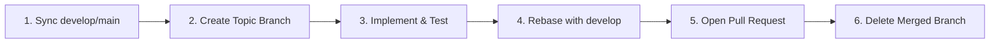

# Git Branching Strategy & Lifecycle Skill

## 1. Overview & Purpose

This skill establishes the branch management policy and naming conventions for the project, aligned with the branching guidelines referenced in [README.md](../../../README.md).

Maintaining consistent branch patterns prevents integration conflicts, keeps repository history legible, and ensures traceable deployments.

---

## 2. Core Repository Branches

| Branch | Stability | Role | Direct Commits Allowed? |
| :--- | :--- | :--- | :---: |
| **`main`** | Production | Stable, production-ready code. Deployed to production environments. | ❌ Forbidden |
| **`staging`** / **`develop`** | Pre-production | Integration branch for testing and reviewing staged features. | ❌ Forbidden |

---

## 3. Topic Branch Naming Conventions

All development must occur on dedicated topic branches branched off `develop` (or `main` in GitHub Flow models).

### 3.1 Prefix & Pattern

Use the standard structure:
`<prefix>/[card-number-]<short-description>`

| Branch Type | Prefix | Description & Example |
| :--- | :--- | :--- |
| **New Features** | `feature/` | New user-facing or platform functionality.<br>`feature/card-14-refresh-token` |
| **Bug Fixes** | `fix/` or `bugfix/` | Bug fixes developed against develop/staging.<br>`fix/card-22-pool-timeout` |
| **Hotfixes** | `hotfix/` | Critical urgent patches applied directly against `main`.<br>`hotfix/auth-payload-bypass` |
| **Documentation** | `docs/` | Exclusively documentation and diagram updates.<br>`docs/api-checkout-diagrams` |
| **AI / Tooling** | `Update/` or `chore/` | Project rules, CI configs, and AI skill maintenance.<br>`Update/AI-content` |
| **Refactoring** | `refactor/` | Structural code changes without functional modifications.<br>`refactor/user-service-di` |

### 3.2 Formatting Rules
- Separate words using hyphens (`-`).
- Never use spaces, underscores, uppercase characters (except standard prefixes like `Update/`), or special characters (`!`, `@`, `#`).
- Keep names concise, typically under **30 characters** after the prefix.

---

## 4. Branch Lifecycle Protocol



### Step 1: Synchronize Base Branch
Always fetch and pull the latest changes before branching:
```bash
git checkout develop
git pull origin develop
```

### Step 2: Create and Switch to Topic Branch
```bash
git checkout -b feature/card-14-refresh-token
```

### Step 3: Keep Branch Updated (Rebase Strategy)
Avoid creating unnecessary merge commits while developing:
```bash
git fetch origin develop
git rebase origin/develop
```

### Step 4: Deletion After Merge
Once the Pull Request is merged into the base branch, clean up local and remote branches:
```bash
# Delete local branch
git branch -d feature/card-14-refresh-token

# Delete remote branch
git push origin --delete feature/card-14-refresh-token
```

---

## 5. Critical Safety Rules

1. **No Direct Commits to Protected Branches**: Never commit directly to `main` or `staging`.
2. **Never Force Push to Shared Branches**: `git push --force` is strictly forbidden on shared branches (`main`, `develop`, `staging`). On feature branches, use `--force-with-lease` only when rebasing your own unshared work.
3. **Always Check Active Branch**: Run `git branch --show-current` before starting work or staging changes.

---

## 6. Verification Checklist

- [ ] Base branch was updated before creating the topic branch.
- [ ] Branch name adheres to `<prefix>/<description>` format.
- [ ] Branch is focused on a single responsibility / card.
- [ ] No unintended commits from other branches are carried over.
