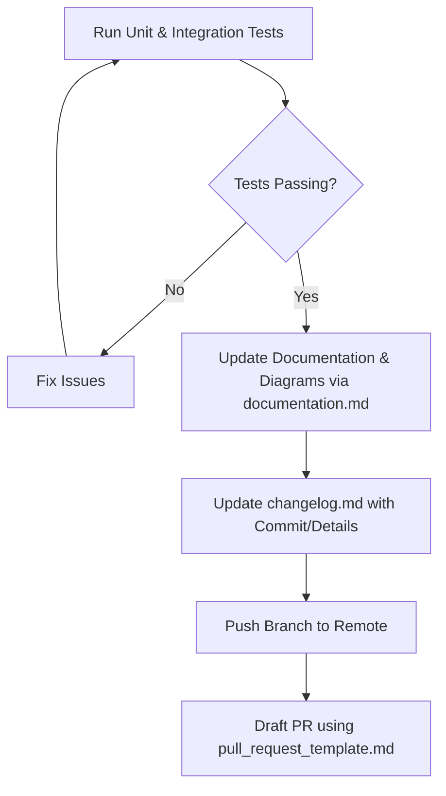

# Git Push & Pull Request Skill

## 1. Overview & Purpose

This skill defines the protocol for pushing code branches to the remote repository and preparing Pull Requests (PRs).

Every Pull Request must strictly conform to the repository template at [.github/pull_request_template.md](file:///home/pedrovotf/Desktop/Projects/Nievo-Sofia/.github/pull_request_template.md) and fulfill all project quality gates prior to submission.

---

## 2. Pre-Push Quality Gate

Before pushing any branch or requesting review, verify that all mandatory criteria are met:



1. **Automated Tests**:
   - Backend unit and integration tests must pass cleanly.
   - Frontend tests must execute without failures.
2. **Documentation & Diagrams**:
   - Verify that affected diagrams (Class, Sequence, DBML, Use Case, Decision Flow) were updated or created under `Documentation/config/docs/` as orchestrated by [documentation.md](../documentation/documentation.md).
3. **Changelog Updated**:
   - Verify [changelog.md](file:///home/pedrovotf/Desktop/Projects/Nievo-Sofia/changelog.md) contains an entry matching its format:
     `YY/MM/DD - [TYPE] - [GENERAL-DESCRIPTION]`
4. **Clean Git Diff**:
   - Inspect `git status` to ensure no untracked temp files, build caches, or `.env` files are accidentally committed.

---

## 3. Pushing Changes

Push your topic branch to the remote origin with upstream tracking:

```bash
# Push branch to remote repository
git push -u origin <branch-name>
```

> [!WARNING]
> Never use `git push --force` on shared branches. If working on a rebased topic branch, use `git push --force-with-lease origin <branch-name>`.

---

## 4. Pull Request Title & Description Template

When drafting the Pull Request on GitHub, use the following standard:

### 4.1 PR Title
Format the title using Conventional Commits / Karma syntax:
`<type>(<scope>): <summary of change> (#[Card/Issue])`

Example:
`feat(auth): implement refresh token rotation mechanism (#14)`

### 4.2 PR Body Template
Fill out all sections of [.github/pull_request_template.md](file:///home/pedrovotf/Desktop/Projects/Nievo-Sofia/.github/pull_request_template.md):

```markdown
### Contain

- [x] Features
- [ ] Bugfix
- [ ] Change
- [x] Documentation
- [x] Test
- [ ] Refactor
- [ ] Build/CI/CD
- [ ] Performance
- [ ] Security
- [ ] Breaking change
- [ ] Rollback
- [ ] Other

### About

Brief summary explaining the rationale and scope of the changes.

### Add to document

- [x] Yes
- [ ] No

### Details

- Add refresh token rotation service and Redis store.
- Add unit and integration tests for token expiry and reuse detection.
- Update sequence diagram in Documentation/config/docs/api/endpoints/auth.md.
- Update changelog.md with feature record.

Card : https://github.com/users/pedrovotf/projects/6/views/1
```

---

## 5. Automated Review Pipeline

Once submitted, the PR triggers the automated review pipeline defined in [.github/workflows/gemini-pr-review.yml](file:///home/pedrovotf/Desktop/Projects/Nievo-Sofia/.github/workflows/gemini-pr-review.yml). The automated reviewer inspects:
- Adherence to SOLID principles and clean architecture.
- Exception handling and resource lifecycle management.
- SQL and database query performance.
- Presence of required unit/integration tests and documentation updates.

---

## 6. Verification Checklist

- [ ] All local tests pass before pushing.
- [ ] Branch pushed to remote with `git push -u origin <branch-name>`.
- [ ] PR title adheres to Conventional Commits format.
- [ ] All relevant checkboxes checked in the PR template.
- [ ] `Add to document` set to `Yes` when architecture, endpoints, or rules changed.
- [ ] GitHub project card link included.
