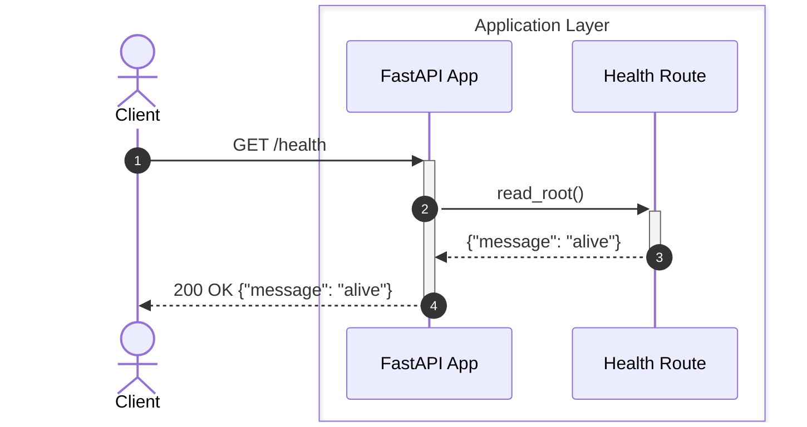
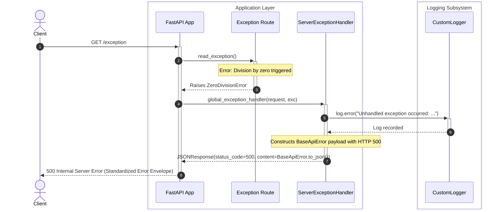

# Auth Service Diagnostics & Endpoints

## 1. Overview
This specification documents the diagnostic, health verification, and exception interception endpoints exposed by the Auth microservice.

---

## 2. Architecture & Sequence Diagrams

### 2.1 Health Check Lifecycle (`GET /health`)

The health endpoint provides basic liveness monitoring for container orchestrators (e.g. Kubernetes, Docker healthchecks):



---

### 2.2 Unhandled Server Exception Flow (`GET /exception`)

The following diagram illustrates how unexpected internal errors are intercepted by the global server exception handler and transformed into a standardized API error response:



---

## 3. Specifications & Contracts

### 3.1 Endpoint Table

| Endpoint | Method | Purpose | Auth Required | Expected Status |
| :--- | :---: | :--- | :---: | :---: |
| `/health` | `GET` | Health check & liveness probe | No | `200 OK` |
| `/exception` | `GET` | Diagnostic route triggering 500 error | No | `500 Internal Server Error` |
| `/docs` | `GET` | Swagger / OpenAPI interactive documentation | No | `200 OK` |
| `/redoc` | `GET` | ReDoc alternative documentation | No | `200 OK` |

### 3.2 Response Payloads

#### Success Response (`/health`):
```json
{
  "message": "alive"
}
```

#### Error Response (`/exception` or Unhandled Errors):
```json
{
  "status": "error",
  "message": "Ops! Something went wrong. Try again later.",
  "data": {
    "details": "division by zero",
    "method": "GET",
    "url": "http://localhost:8000/exception"
  },
  "errors": [
    "Internal Server Error"
  ],
  "count": 1
}
```

---

## 4. Related Implementation Files
- [`main.py`](file:///home/pedrovotf/Desktop/Projects/Nievo-Sofia/Code/Back-end/Auth/src/main.py)
- [`server_exception_handler.py`](file:///home/pedrovotf/Desktop/Projects/Nievo-Sofia/Code/Back-end/Auth/src/core/middleware/server_exception_handler.py)
- [`base_api_error.py`](file:///home/pedrovotf/Desktop/Projects/Nievo-Sofia/Code/Back-end/Auth/src/contracts/default/base_api_error.py)
- [`logging.py`](file:///home/pedrovotf/Desktop/Projects/Nievo-Sofia/Code/Back-end/Auth/src/core/logging.py)
