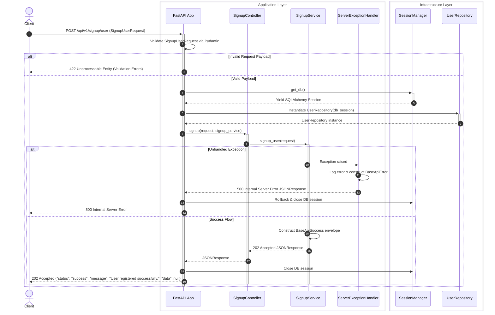

# User Signup Endpoint (`POST /api/v1/signup/user`)

## 1. Overview
The **User Signup Endpoint** provides initial onboarding and account registration for users within the Sofia platform. It receives client registration payloads (`SignupUserRequest`), validates email formatting, password length boundaries, and terms acceptance, injects a managed SQLAlchemy database session via `SessionManager`, and delegates processing to `SignupService` and `UserRepository`.

---

## 2. Architecture & Sequence Diagram

The following Mermaid sequence diagram details the complete request lifecycle, including Pydantic input validation, dependency-injected database session and repository resolution, service processing, and error interception:



---

## 3. Specifications & Contracts

### 3.1 HTTP Request
- **Method**: `POST`
- **Path**: `/api/v1/signup/user`
- **Headers**: `Content-Type: application/json`

#### Request Body (`SignupUserRequest`)
| Field | Type | Required | Description |
| :--- | :--- | :---: | :--- |
| `email` | `EmailStr` | Yes | Valid email address according to RFC standards. |
| `password` | `string` | Yes | Password between 6 and 20 characters. |
| `accept_terms` | `boolean` | Yes | Confirmation of terms of service acceptance. |

```json
{
  "email": "user@example.com",
  "password": "securePassword123",
  "accept_terms": true
}
```

### 3.2 HTTP Responses

#### Success Response (`202 Accepted`)
```json
{
  "message": "User registered successfully.",
  "data": null,
  "status": "success"
}
```

#### Validation Error (`422 Unprocessable Entity`)
```json
{
  "detail": [
    {
      "loc": ["body", "email"],
      "msg": "value is not a valid email address",
      "type": "value_error"
    }
  ]
}
```

#### Internal Server Error (`500 Internal Server Error`)
```json
{
  "status": "false",
  "message": "Ops! Something went wrong. Try again later.",
  "data": {
    "details": {},
    "method": "POST",
    "url": "http://localhost:8000/api/v1/signup/user"
  },
  "errors": []
}
```

---

## 4. Related Implementation Files
- [`main.py`](file:///home/pedrovotf/Desktop/Projects/Nievo-Sofia/Code/Back-end/Auth/src/main.py)
- [`router.py`](file:///home/pedrovotf/Desktop/Projects/Nievo-Sofia/Code/Back-end/Auth/src/api/router.py)
- [`controller.py`](file:///home/pedrovotf/Desktop/Projects/Nievo-Sofia/Code/Back-end/Auth/src/service/signup/controller.py)
- [`service.py`](file:///home/pedrovotf/Desktop/Projects/Nievo-Sofia/Code/Back-end/Auth/src/service/signup/service.py)
- [`request.py`](file:///home/pedrovotf/Desktop/Projects/Nievo-Sofia/Code/Back-end/Auth/src/service/signup/request.py)
- [`session_manager.py`](file:///home/pedrovotf/Desktop/Projects/Nievo-Sofia/Code/Back-end/Auth/src/core/database/session_manager.py)
- [`user.py` (Repository)](file:///home/pedrovotf/Desktop/Projects/Nievo-Sofia/Code/Back-end/Auth/src/repositories/user.py)
- [`user.py` (Entity)](file:///home/pedrovotf/Desktop/Projects/Nievo-Sofia/Code/Back-end/Auth/src/contracts/entities/user.py)
- [`base_api_sucess.py`](file:///home/pedrovotf/Desktop/Projects/Nievo-Sofia/Code/Back-end/Auth/src/schema/default/base_api_sucess.py)
- [`base_api_error.py`](file:///home/pedrovotf/Desktop/Projects/Nievo-Sofia/Code/Back-end/Auth/src/schema/default/base_api_error.py)
- [`server_exception_handler.py`](file:///home/pedrovotf/Desktop/Projects/Nievo-Sofia/Code/Back-end/Auth/src/core/middleware/server_exception_handler.py)
