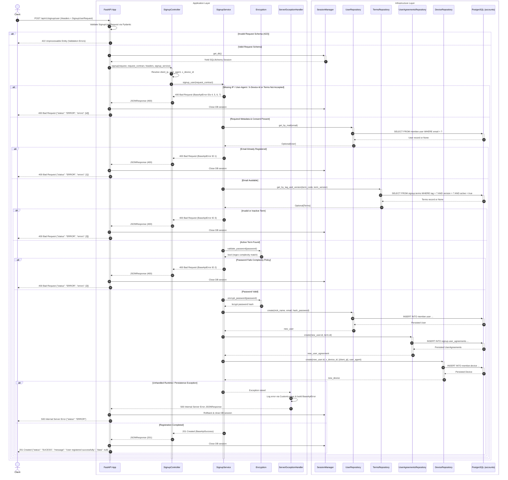

# User Signup Endpoint (`POST /api/v1/signup/user`)

## 1. Overview
The **User Signup Endpoint** provides complete user onboarding and account registration for the Sofia platform. It extracts client telemetry headers (`X-Forwarded-For`, `User-Agent`, `X-Device-Id`), validates registration payloads (`SignupUserRequest`), enforces terms acceptance and active terms version verification, checks email uniqueness, validates password complexity rules, hashes passwords with bcrypt, and persists the user (`member.user`), legal agreement (`signup.user_agreements`), and client device (`member.device`) in PostgreSQL.

---

## 2. Architecture & Sequence Diagram

The following Mermaid sequence diagram details the end-to-end request lifecycle across FastAPI validation, header extraction, dependency-injected repositories, password encryption, PostgreSQL persistence, and error handling:



---

## 3. Specifications & Contracts

### 3.1 HTTP Request
- **Method**: `POST`
- **Path**: `/api/v1/signup/user`

#### Request Headers
| Header | Type | Required | Description |
| :--- | :--- | :---: | :--- |
| `Content-Type` | `string` | Yes | Must be `application/json`. |
| `X-Device-Id` | `string` | Yes | Unique client device identifier (up to 200 characters). |
| `User-Agent` | `string` | Yes | Client application or browser User-Agent string. |
| `X-Forwarded-For` | `string` | No | Proxy-forwarded client IP list; falls back to `request.client.host`. |

#### Request Body (`SignupUserRequest`)
| Field | Type | Required | Constraints & Description |
| :--- | :--- | :---: | :--- |
| `nick_name` | `string` | Yes | Public display nickname between 1 and 150 characters. |
| `email` | `EmailStr` | Yes | Valid RFC-compliant email address (unique in `member.user`). |
| `password` | `string` | Yes | Between 8 and 16 characters; must satisfy `REGEX_FOR_PASSWORD` (digit, lowercase, uppercase, special character, no spaces). |
| `accept_terms` | `boolean` | Yes | Explicit confirmation of terms acceptance (`true` required). |
| `term_code` | `string` | Yes | Identifier tag of the accepted terms document (1–50 characters). |
| `term_version` | `integer` | Yes | Version number of the accepted terms document (`>= 1`, must be active). |

```json
{
  "nick_name": "sofia_reader",
  "email": "user@example.com",
  "password": "Secure@123",
  "accept_terms": true,
  "term_code": "TERMS_OF_USE",
  "term_version": 1
}
```

### 3.2 HTTP Responses

#### Success Response (`201 Created`)
```json
{
  "message": "User registered successfully.",
  "data": null,
  "status": "SUCESS"
}
```

#### Business Validation Error (`400 Bad Request`)
```json
{
  "message": "Email or username invalid",
  "data": null,
  "status": "ERROR",
  "errors": [1]
}
```

##### Domain Error Code Catalog (`EResponseAuth`)
| Error ID | Enum Member | Message |
| :---: | :--- | :--- |
| `1` | `SIGNUP_400_SIGNUP_USER_USER_ALREADY_EXISTS` | `"Email or username invalid"` |
| `2` | `SIGNUP_400_SIGNUP_USER_PASSWORD_INVALID` | `"The password must contain a single digit from 0 to 9, lowercase letter, no space,uppercase letter, special character and a size between 8 and 16"` |
| `3` | `SIGNUP_400_SIGNUP_USER_TERM_INVALID` | `"Invalid term code or version"` |
| `3` | `SIGNUP_400_SIGNUP_USER_NOT_CREATED_USER` | `"Sorry! that user could not be created, please try again later"` |
| `3` | `SIGNUP_400_SIGNUP_USER_NOT_CREATED_AGREEMENTS` | `"Sorry! that user could not be created, please try again later"` |
| `4` | `SIGNUP_400_SIGNUP_USER_TERMS_NOT_ACCEPTED` | `"You must accept the terms and conditions to continue"` |
| `5` | `SIGNUP_400_SIGNUP_USER_IP_NOT_FOUND` | `"The client IP address could not be determined"` |
| `6` | `SIGNUP_400_SIGNUP_USER_USER_AGENT_NOT_FOUND` | `"The user agent could not be determined"` |
| `7` | `SIGNUP_400_SIGNUP_USER_DEVICE_ID_NOT_FOUND` | `"The device ID could not be determined"` |
| `8` | `SIGNUP_400_SIGNUP_USER_NOT_CREATED_DEVICE` | `"Sorry! that user could not be created, please try again later"` |

#### Schema Validation Error (`422 Unprocessable Entity`)
```json
{
  "detail": [
    {
      "loc": ["body", "email"],
      "msg": "value is not a valid email address",
      "type": "value_error"
    }
  ]
}
```

#### Internal Server Error (`500 Internal Server Error`)
```json
{
  "message": "Ops! Something went wrong. Try again later.",
  "data": {
    "details": {},
    "method": "POST",
    "url": "http://localhost:8000/api/v1/signup/user"
  },
  "status": "ERROR",
  "errors": ["Internal Server Error"]
}
```

---

## 4. Related Implementation Files
- [`main.py`](file:///home/pedrovotf/Desktop/Projects/Nievo-Sofia/Code/Back-end/Auth/src/main.py)
- [`router.py`](file:///home/pedrovotf/Desktop/Projects/Nievo-Sofia/Code/Back-end/Auth/src/api/router.py)
- [`controller.py`](file:///home/pedrovotf/Desktop/Projects/Nievo-Sofia/Code/Back-end/Auth/src/service/signup/controller.py)
- [`service.py`](file:///home/pedrovotf/Desktop/Projects/Nievo-Sofia/Code/Back-end/Auth/src/service/signup/service.py)
- [`request.py`](file:///home/pedrovotf/Desktop/Projects/Nievo-Sofia/Code/Back-end/Auth/src/service/signup/request.py)
- [`encryption.py`](file:///home/pedrovotf/Desktop/Projects/Nievo-Sofia/Code/Back-end/Auth/src/core/encryption.py)
- [`Eresponse_auth.py`](file:///home/pedrovotf/Desktop/Projects/Nievo-Sofia/Code/Back-end/Auth/src/core/enum/Eresponse_auth.py)
- [`Estatus_base_api.py`](file:///home/pedrovotf/Desktop/Projects/Nievo-Sofia/Code/Back-end/Auth/src/core/enum/Estatus_base_api.py)
- [`session_manager.py`](file:///home/pedrovotf/Desktop/Projects/Nievo-Sofia/Code/Back-end/Auth/src/core/database/session_manager.py)
- [`user.py` (Repository)](file:///home/pedrovotf/Desktop/Projects/Nievo-Sofia/Code/Back-end/Auth/src/repositories/user.py)
- [`terms.py` (Repository)](file:///home/pedrovotf/Desktop/Projects/Nievo-Sofia/Code/Back-end/Auth/src/repositories/terms.py)
- [`user_agreements.py` (Repository)](file:///home/pedrovotf/Desktop/Projects/Nievo-Sofia/Code/Back-end/Auth/src/repositories/user_agreements.py)
- [`device.py` (Repository)](file:///home/pedrovotf/Desktop/Projects/Nievo-Sofia/Code/Back-end/Auth/src/repositories/device.py)
- [`base_api_sucess.py`](file:///home/pedrovotf/Desktop/Projects/Nievo-Sofia/Code/Back-end/Auth/src/schema/default/base_api_sucess.py)
- [`base_api_error.py`](file:///home/pedrovotf/Desktop/Projects/Nievo-Sofia/Code/Back-end/Auth/src/schema/default/base_api_error.py)
- [`server_exception_handler.py`](file:///home/pedrovotf/Desktop/Projects/Nievo-Sofia/Code/Back-end/Auth/src/core/middleware/server_exception_handler.py)
