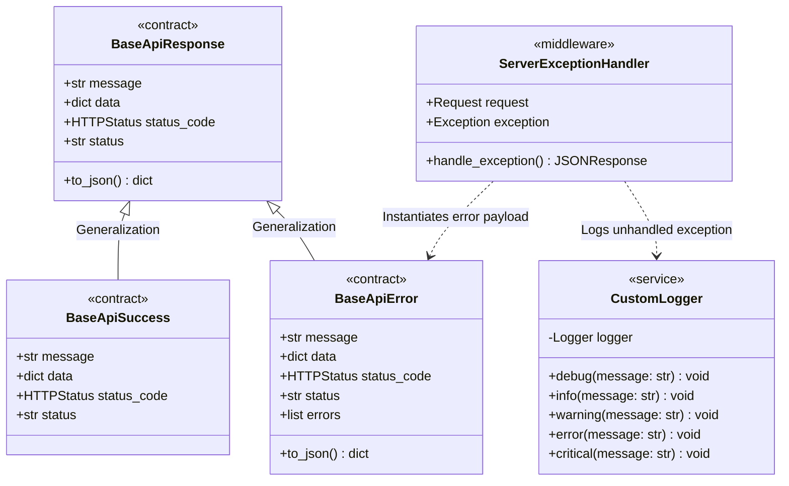

# Auth Microservice Domain Models & Contracts

## 1. Overview
The **Auth Microservice** is responsible for authentication, identity management, and credential verification within the Sofia ecosystem. This module defines the foundational communication contracts, standardized API response structures, custom logger wrappers, and unhandled exception middleware.

---

## 2. Architecture & Class Diagram

The following Mermaid class diagram illustrates the object hierarchy of the standard API response envelopes, the logging subsystem, and the exception handling middleware:



---

## 3. Specifications & Contracts

### 3.1 Base API Responses
All microservice endpoints adhere to a standardized JSON response envelope:

- **[`BaseApiResponse`](file:///home/pedrovotf/Desktop/Projects/Nievo-Sofia/Code/Back-end/Auth/src/contracts/default/base_api_response.py)**:
  - `status`: String indicator (`success` or `error`).
  - `message`: User-friendly human-readable message.
  - `data`: Arbitrary dictionary payload containing payload details.
  - `status_code`: Corresponding `http.HTTPStatus` code.
  - `to_json()`: Converts the response instance into an API-compliant dictionary:
    ```json
    {
      "status": "success",
      "message": "Operation executed successfully",
      "data": {}
    }
    ```

- **[`BaseApiSuccess`](file:///home/pedrovotf/Desktop/Projects/Nievo-Sofia/Code/Back-end/Auth/src/contracts/default/base_api_sucess.py)**:
  - Extends `BaseApiResponse` with default values: `status="success"`, `message="executed with success"`, `status_code=HTTPStatus.OK`.

- **[`BaseApiError`](file:///home/pedrovotf/Desktop/Projects/Nievo-Sofia/Code/Back-end/Auth/src/contracts/default/base_api_error.py)**:
  - Extends `BaseApiResponse` with default values: `status="error"`, `message="An error occurred"`, `status_code=HTTPStatus.BAD_REQUEST`.
  - Additional field `errors`: List of validation or domain error strings.
  - Additional field `count`: Number of errors present in `errors`.

### 3.2 Core Logging Subsystem
- **[`CustomLogger`](file:///home/pedrovotf/Desktop/Projects/Nievo-Sofia/Code/Back-end/Auth/src/core/logging.py)**:
  - Encapsulates Python's native `logging.Logger`.
  - Configured with a default timestamp format `YYYY-MM-DD HH:MM:SS` and log levels (`DEBUG`, `INFO`, `WARNING`, `ERROR`, `CRITICAL`).

### 3.3 Server Exception Handler
- **[`ServerExceptionHandler`](file:///home/pedrovotf/Desktop/Projects/Nievo-Sofia/Code/Back-end/Auth/src/core/middleware/server_exception_handler.py)**:
  - Intercepts unexpected runtime exceptions during HTTP request lifecycle.
  - Records error logs using `CustomLogger.error(...)` including request method and URL.
  - Generates a structured HTTP 500 JSON response utilizing `BaseApiError`.

---

## 4. Related Implementation Files
- [`base_api_response.py`](file:///home/pedrovotf/Desktop/Projects/Nievo-Sofia/Code/Back-end/Auth/src/contracts/default/base_api_response.py)
- [`base_api_sucess.py`](file:///home/pedrovotf/Desktop/Projects/Nievo-Sofia/Code/Back-end/Auth/src/contracts/default/base_api_sucess.py)
- [`base_api_error.py`](file:///home/pedrovotf/Desktop/Projects/Nievo-Sofia/Code/Back-end/Auth/src/contracts/default/base_api_error.py)
- [`logging.py`](file:///home/pedrovotf/Desktop/Projects/Nievo-Sofia/Code/Back-end/Auth/src/core/logging.py)
- [`server_exception_handler.py`](file:///home/pedrovotf/Desktop/Projects/Nievo-Sofia/Code/Back-end/Auth/src/core/middleware/server_exception_handler.py)
- [`main.py`](file:///home/pedrovotf/Desktop/Projects/Nievo-Sofia/Code/Back-end/Auth/src/main.py)
