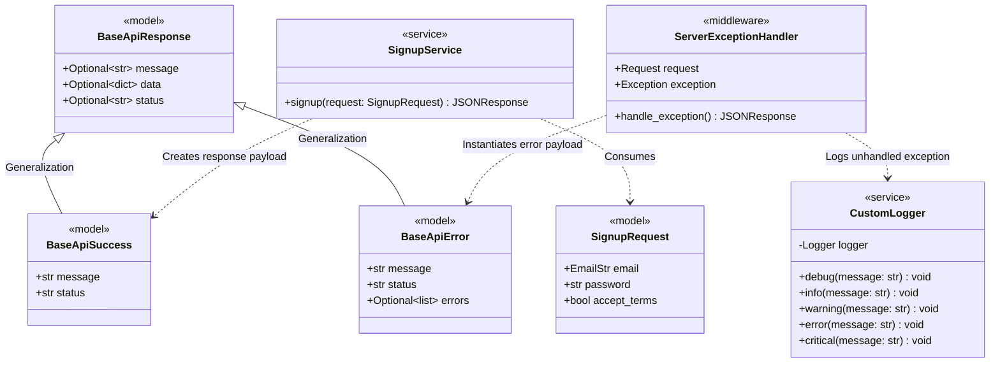

# Auth Microservice Domain Models, Schemas & Services

## 1. Overview
The **Auth Microservice** is responsible for authentication, identity management, and credential verification within the Sofia ecosystem. This module defines the foundational communication schemas using Pydantic models, standardized API response envelopes, signup application services, custom logger wrappers, and unhandled exception middleware.

---

## 2. Architecture & Class Diagram

The following Mermaid class diagram illustrates the object hierarchy of the standard Pydantic response models, signup service components, logging subsystem, and exception handling middleware:

---

## 3. Specifications & Schemas

### 3.1 Base API Response Schemas
All microservice endpoints adhere to a standardized JSON response envelope backed by Pydantic models:

- **[`BaseApiResponse`](file:///home/pedrovotf/Desktop/Projects/Nievo-Sofia/Code/Back-end/Auth/src/schema/default/base_api_response.py)**:
  - `status`: String indicator (`"true"` or `"false"`).
  - `message`: User-friendly human-readable message.
  - `data`: Arbitrary dictionary payload containing response details.
  - Serialized via Pydantic `model_dump(mode="json")`.

- **[`BaseApiSuccess`](file:///home/pedrovotf/Desktop/Projects/Nievo-Sofia/Code/Back-end/Auth/src/schema/default/base_api_sucess.py)**:
  - Extends `BaseApiResponse` with default values: `status="true"`, `message="executed with success"`.

- **[`BaseApiError`](file:///home/pedrovotf/Desktop/Projects/Nievo-Sofia/Code/Back-end/Auth/src/schema/default/base_api_error.py)**:
  - Extends `BaseApiResponse` with default values: `status="false"`, `message="An error occurred"`.
  - Additional field `errors`: List of validation or domain error strings.

### 3.2 Signup Domain Service & Validation
- **[`SignupRequest`](file:///home/pedrovotf/Desktop/Projects/Nievo-Sofia/Code/Back-end/Auth/src/service/signup/request.py)**:
  - Validates `email` as a valid email address via `EmailStr`.
  - Restricts `password` between 6 and 20 characters.
  - Requires explicit boolean confirmation for `accept_terms`.
- **[`SignupService`](file:///home/pedrovotf/Desktop/Projects/Nievo-Sofia/Code/Back-end/Auth/src/service/signup/service.py)**:
  - Encapsulates registration logic, returning an HTTP 202 Accepted envelope.

### 3.3 Core Logging Subsystem
- **[`CustomLogger`](file:///home/pedrovotf/Desktop/Projects/Nievo-Sofia/Code/Back-end/Auth/src/core/logging.py)**:
  - Encapsulates Python's native `logging.Logger`.
  - Configured with default timestamp format `YYYY-MM-DD HH:MM:SS` and log levels (`DEBUG`, `INFO`, `WARNING`, `ERROR`, `CRITICAL`).

### 3.4 Server Exception Handler
- **[`ServerExceptionHandler`](file:///home/pedrovotf/Desktop/Projects/Nievo-Sofia/Code/Back-end/Auth/src/core/middleware/server_exception_handler.py)**:
  - Intercepts unexpected runtime exceptions during HTTP request lifecycle.
  - Records error logs using `CustomLogger.error(...)` including request method and URL.
  - Generates a structured HTTP 500 JSON response utilizing `BaseApiError`. Exception details are sanitized and only included in payload when `DEBUG="True"`.

---

## 4. Related Implementation Files
- [`base_api_response.py`](file:///home/pedrovotf/Desktop/Projects/Nievo-Sofia/Code/Back-end/Auth/src/schema/default/base_api_response.py)
- [`base_api_sucess.py`](file:///home/pedrovotf/Desktop/Projects/Nievo-Sofia/Code/Back-end/Auth/src/schema/default/base_api_sucess.py)
- [`base_api_error.py`](file:///home/pedrovotf/Desktop/Projects/Nievo-Sofia/Code/Back-end/Auth/src/schema/default/base_api_error.py)
- [`request.py`](file:///home/pedrovotf/Desktop/Projects/Nievo-Sofia/Code/Back-end/Auth/src/service/signup/request.py)
- [`service.py`](file:///home/pedrovotf/Desktop/Projects/Nievo-Sofia/Code/Back-end/Auth/src/service/signup/service.py)
- [`controller.py`](file:///home/pedrovotf/Desktop/Projects/Nievo-Sofia/Code/Back-end/Auth/src/service/signup/controller.py)
- [`logging.py`](file:///home/pedrovotf/Desktop/Projects/Nievo-Sofia/Code/Back-end/Auth/src/core/logging.py)
- [`server_exception_handler.py`](file:///home/pedrovotf/Desktop/Projects/Nievo-Sofia/Code/Back-end/Auth/src/core/middleware/server_exception_handler.py)
- [`main.py`](file:///home/pedrovotf/Desktop/Projects/Nievo-Sofia/Code/Back-end/Auth/src/main.py)
