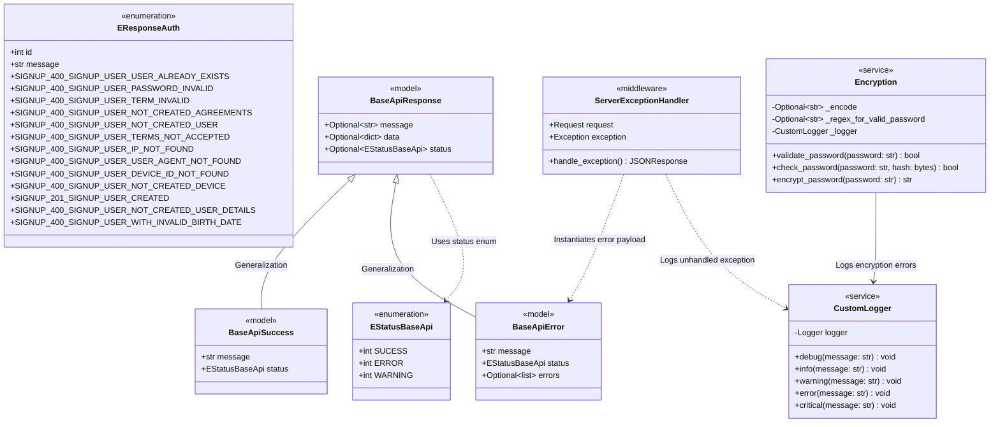

# Auth Microservice Domain Models, Schemas & Services

## 1. Overview
The **Auth Microservice** is responsible for authentication, identity management, terms compliance, device tracking, and credential security within the Sofia ecosystem. This module defines standardized API response envelopes and status enumerations, domain error catalogs, bcrypt password encryption utilities, SQLAlchemy database session management, declarative ORM entities, abstract repository interfaces, concrete persistence repositories, signup application services, custom logger wrappers, and unhandled exception middleware.

---

## 2. Architecture & Class Diagrams

### 2.1 Core Schemas, Enumerations, Encryption & Exception Middleware

The following Mermaid class diagram illustrates the standardized Pydantic response models, status and error enumerations, password encryption service, logging wrapper, and global exception handling middleware:

---

### 2.2 ORM Entities, Repository Contracts & Signup Application Layer

The following Mermaid class diagram details the SQLAlchemy ORM entities (`member` and `signup` schemas), the `IRepositories` abstraction, concrete data access repositories, and the dependency-injected signup controller and service layer:

```mermaid
classDiagram
    direction TB

    class Base {
        <<entity>>
    }

    class User {
        <<entity>>
        +UUID id
        +Optional~str~ full_name
        +Optional~str~ nick_name
        +Optional~str~ email
        +Optional~str~ phone
        +bool active
        +str password
        +datetime created_at
        +datetime updated_at
        +__repr__() str
    }

    class Device {
        <<entity>>
        +UUID id
        +UUID user_id
        +str x_device_id
        +Optional~str~ user_agent
        +Optional~list~ ip_list
        +bool active
        +datetime created_at
        +datetime updated_at
    }

    class Terms {
        <<entity>>
        +int id
        +str name
        +str tag
        +str content
        +int version
        +bool active
        +datetime created_at
        +datetime updated_at
    }

    class UserAgreements {
        <<entity>>
        +UUID id
        +UUID user_id
        +int term_id
        +datetime created_at
    }

    class UserDetails {
        <<entity>>
        +UUID id
        +UUID user_id
        +datetime born_date
        +Optional~int~ country_id
        +bool validated_email
        +bool validated_phone
        +Optional~str~ address
        +Optional~str~ document
        +datetime created_at
        +datetime updated_at
    }

    class SessionManager {
        <<service>>
        -Optional~Engine~ _engine
        -Optional~sessionmaker~ _session_factory
        +initialize(db_url: str, pool_size: int, max_overflow: int) void
        +get_db() Generator~Session~
        +get_session() Session
        +close() void
    }

    class IRepositories {
        <<interface>>
        +get_by_id(entity_id: UUID | int) Any
        +create(**kwargs) Any
    }

    class UserRepository {
        <<repository>>
        +Session db
        +get_by_id(user_id: UUID) Optional~User~
        +get_by_mail(user_email: str) Optional~User~
        +create_without_commit(session: Session, nick_name: str, email: str, password: str) tuple~User, bool~
        +create(nick_name: str, email: str, password: str) User
        +update(user: User) User
    }

    class UserDetailsRepository {
        <<repository>>
        +Session db
        +get_by_id(detail_id: UUID) Optional~UserDetails~
        +create_without_commit(session: Session, user_id: UUID, born_date: datetime) tuple~UserDetails, bool~
        +create(born_date: datetime, user_id: UUID) UserDetails
        +update(user_details: UserDetails) UserDetails
    }

    class DeviceRepository {
        <<repository>>
        +Session db
        +get_by_id(device_id: UUID) Optional~Device~
        +create_without_commit(session: Session, user_id: UUID, x_device_id: str, ip_list: Optional~list~, user_agent: Optional~str~) tuple~Device, bool~
        +create(user_id: UUID, x_device_id: str, ip_list: Optional~list~, user_agent: Optional~str~) Device
    }

    class TermsRepository {
        <<repository>>
        +Session db
        +get_by_id(term_id: int) Optional~Terms~
        +get_by_tag_and_version(tag: str, version: int) Optional~Terms~
        +create_without_commit(session: Session, name: str, tag: str, content: str, version: int, active: bool) tuple~Terms, bool~
        +create(name: str, tag: str, content: str, version: int, active: bool) Terms
    }

    class UserAgreementsRepository {
        <<repository>>
        +Session db
        +get_by_id(agreement_id: UUID) Optional~UserAgreements~
        +create_without_commit(session: Session, user_id: UUID, term_id: int) tuple~UserAgreements, bool~
        +create(user_id: UUID, term_id: int) UserAgreements
    }

    class SignupUserRequest {
        <<model>>
        +str nick_name
        +EmailStr email
        +str password
        +bool accept_terms
        +str term_code
        +int term_version
        +PastDate born_date
        +Optional~str~ client_ip
        +Optional~str~ x_device_id
        +Optional~str~ user_agent
    }

    class SignupUserValidator {
        <<validator>>
        +validate_request(request: SignupUserRequest)$ tuple~HTTPStatus, BaseApiResponse~
    }

    class SignupService {
        <<service>>
        -CustomLogger _logger
        -Session _db_transaction
        -UserRepository _user_repository
        -UserAgreementsRepository _user_agreement_repository
        -UserDetailsRepository _user_details_repository
        -DeviceRepository _device_repository
        -TermsRepository _terms_repository
        -Encryption _encryption_service
        +signup_user(request: SignupUserRequest) tuple~HTTPStatus, BaseApiResponse~
    }

    class SignupController {
        <<controller>>
        +signup(request: Request, request_contract: SignupUserRequest, signup_service: SignupService, x_forwarded_for: Optional~str~, user_agent: str, x_device_id: str) JSONResponse
    }

    class Encryption {
        <<service>>
        +validate_password(password: str) bool
        +encrypt_password(password: str) str
    }

    Base <|-- User : Generalization
    Base <|-- UserDetails : Generalization
    Base <|-- Device : Generalization
    Base <|-- Terms : Generalization
    Base <|-- UserAgreements : Generalization

    UserRepository ..|> IRepositories : Realization
    UserDetailsRepository ..|> IRepositories : Realization
    DeviceRepository ..|> IRepositories : Realization
    TermsRepository ..|> IRepositories : Realization
    UserAgreementsRepository ..|> IRepositories : Realization

    UserRepository ..> SessionManager : Injects DB session
    UserDetailsRepository ..> SessionManager : Injects DB session
    DeviceRepository ..> SessionManager : Injects DB session
    TermsRepository ..> SessionManager : Injects DB session
    UserAgreementsRepository ..> SessionManager : Injects DB session

    UserRepository ..> User : Queries and persists
    UserDetailsRepository ..> UserDetails : Queries and persists
    DeviceRepository ..> Device : Queries and persists
    TermsRepository ..> Terms : Queries and persists
    UserAgreementsRepository ..> UserAgreements : Queries and persists

    SignupController --> SignupService : Delegates signup
    SignupController ..> SignupUserRequest : Enriches client metadata
    SignupService --> SignupUserValidator : Delegates validation
    SignupUserValidator ..> SignupUserRequest : Validates metadata and age
    SignupService --> UserRepository : Depends on
    SignupService --> UserDetailsRepository : Depends on
    SignupService --> UserAgreementsRepository : Depends on
    SignupService --> DeviceRepository : Depends on
    SignupService --> TermsRepository : Depends on
    SignupService --> Encryption : Depends on
    SignupService ..> SignupUserRequest : Processes
```

---

## 3. Specifications & Schemas

### 3.1 Base API Response Schemas & Enumerations
All microservice endpoints adhere to a standardized JSON response envelope backed by Pydantic models and typed status enums:

- **[`EStatusBaseApi`](../../../../../Code/Back-end/Auth/src/core/enum/Estatus_base_api.py)**:
  - Defines canonical envelope statuses: `SUCESS` (`1`), `ERROR` (`2`), and `WARNING` (`3`).
- **[`EResponseAuth`](../../../../../Code/Back-end/Auth/src/core/enum/Eresponse_auth.py)**:
  - Domain error and response catalog following `SERVICE_HTTPSTATUS_METHOD_REASON`, mapping structured numeric IDs (`1` through `11`) and user-facing validation messages for signup flows.
- **[`BaseApiResponse`](../../../../../Code/Back-end/Auth/src/schema/default/base_api_response.py)**:
  - `status`: Standardized `EStatusBaseApi` indicator.
  - `message`: User-friendly human-readable message.
  - `data`: Arbitrary dictionary payload containing response details.
  - Serialized via Pydantic `model_dump(mode="json")`.
- **[`BaseApiSuccess`](../../../../../Code/Back-end/Auth/src/schema/default/base_api_sucess.py)**:
  - Extends `BaseApiResponse` with defaults: `status="SUCESS"` (`EStatusBaseApi.SUCESS.name`), `message="executed with success"`.
- **[`BaseApiError`](../../../../../Code/Back-end/Auth/src/schema/default/base_api_error.py)**:
  - Extends `BaseApiResponse` with defaults: `status="ERROR"` (`EStatusBaseApi.ERROR.name`), `message="An error occurred"`.
  - Additional field `errors`: List of numeric domain error codes or validation error strings.

### 3.2 Password Encryption & Policy Service
- **[`Encryption`](../../../../../Code/Back-end/Auth/src/core/encryption.py)**:
  - Loads `ENCODE_ENCRYPT_PASSWORD` and `REGEX_FOR_PASSWORD` from environment variables on initialization.
  - `validate_password(password)`: Verifies password complexity against `REGEX_FOR_PASSWORD` (`re.fullmatch`).
  - `encrypt_password(password)`: Generates a salt via `bcrypt.gensalt()` and hashes the encoded password with `bcrypt.hashpw`, logging unexpected failures through `CustomLogger`.
  - `check_password(password, hash)`: Verifies plain-text password attempts against stored bcrypt hashes via `bcrypt.checkpw`.

### 3.3 Database Session Management, ORM Entities & Repositories
- **[`SessionManager`](../../../../../Code/Back-end/Auth/src/core/database/session_manager.py)**:
  - Manages the SQLAlchemy `Engine` connection pool (`pool_pre_ping=True`, configurable `pool_size` and `max_overflow`) and `sessionmaker` lifecycle during FastAPI `lifespan`.
- **[`IRepositories`](../../../../../Code/Back-end/Auth/src/contracts/interface/Irepositories.py)**:
  - Abstract base contract (`ABC`) enforcing `get_by_id` across all persistence repositories.
- **ORM Entities**:
  - **[`Base`](../../../../../Code/Back-end/Auth/src/contracts/entities/model.py)**: SQLAlchemy 2.0 `DeclarativeBase`.
  - **[`User`](../../../../../Code/Back-end/Auth/src/contracts/entities/user.py)**: Mapped to `member.user` with UUIDv7 `id`, `full_name`, `nick_name`, `email`, `phone`, `password` (bcrypt hash), `active`, `created_at`, and `updated_at`.
  - **[`UserDetails`](../../../../../Code/Back-end/Auth/src/contracts/entities/user_details.py)**: Mapped to `member.user_details` with UUIDv7 `id`, `user_id`, `born_date` (`DateTime`), `country_id`, `validated_email`, `validated_phone`, `address`, `document`, `created_at`, and `updated_at`.
  - **[`Device`](../../../../../Code/Back-end/Auth/src/contracts/entities/device.py)**: Mapped to `member.device` with UUIDv7 `id`, `user_id`, `x_device_id` (`String(200)`), `user_agent` (`String(200)`), `ip_list` (`ARRAY(String)`), `active`, `created_at`, and `updated_at`.
  - **[`Terms`](../../../../../Code/Back-end/Auth/src/contracts/entities/terms.py)**: Mapped to `signup.terms` with integer `id`, `name`, `tag`, `content`, `version`, `active`, `created_at`, and `updated_at`.
  - **[`UserAgreements`](../../../../../Code/Back-end/Auth/src/contracts/entities/user_agreements.py)**: Mapped to `signup.user_agreements` with UUIDv7 `id`, `user_id`, `term_id`, and `created_at`.
- **Concrete Repositories**:
  - **[`UserRepository`](../../../../../Code/Back-end/Auth/src/repositories/user.py)**: Implements `get_by_id`, `get_by_mail`, `create_without_commit(session, nick_name, email, password)`, `create`, and `update` with rollback protection.
  - **[`UserDetailsRepository`](../../../../../Code/Back-end/Auth/src/repositories/user_details.py)**: Implements `get_by_id`, `create_without_commit(session, user_id, born_date)`, `create`, and `update` with rollback protection.
  - **[`DeviceRepository`](../../../../../Code/Back-end/Auth/src/repositories/device.py)**: Implements `get_by_id`, `create_without_commit(session, user_id, x_device_id, ip_list, user_agent)`, and `create`.
  - **[`TermsRepository`](../../../../../Code/Back-end/Auth/src/repositories/terms.py)**: Implements `get_by_id`, `get_by_tag_and_version(tag, version)` (filtering `active == True`), `create_without_commit`, and `create`.
  - **[`UserAgreementsRepository`](../../../../../Code/Back-end/Auth/src/repositories/user_agreements.py)**: Implements `get_by_id`, `create_without_commit(session, user_id, term_id)`, and `create`.

### 3.4 Signup Domain Service & Validation
- **[`SignupUserRequest`](../../../../../Code/Back-end/Auth/src/service/signup/request.py)**:
  - Validates `nick_name` (1–150 chars), `email` (`EmailStr`), `password` (8–16 chars), `accept_terms` (`bool`), `term_code` (1–50 chars), `term_version` (`>= 1`), and `born_date` (`PastDate`).
  - Carries optional excluded runtime context fields (`client_ip`, `x_device_id`, `user_agent`) populated by the HTTP controller from request headers and socket metadata.
- **[`SignupUserValidator`](../../../../../Code/Back-end/Auth/src/service/signup/validator/signup_user_validator.py)**:
  - Validates client telemetry headers (`client_ip`, `user_agent`, `x_device_id`), terms acceptance consent (`accept_terms is True`), and age bounds against `MIN_AGE_FOR_ACCOUNT` and `MAX_AGE_FOR_ACCOUNT`.
- **[`SignupService`](../../../../../Code/Back-end/Auth/src/service/signup/service.py)**:
  - Orchestrates validation delegation to `SignupUserValidator`, duplicate email prevention, active terms lookup, password regex validation, and bcrypt hashing.
  - Manages atomic relational persistence via an explicit SQLAlchemy session transaction (`self._db_transaction`): executes `create_without_commit` across `User`, `UserDetails`, `UserAgreements`, and `Device`, executing `rollback()` on failure or `commit()` returning HTTP 201 `BaseApiSuccess`.

### 3.5 Core Logging & Server Exception Handler
- **[`CustomLogger`](../../../../../Code/Back-end/Auth/src/core/logging.py)**:
  - Encapsulates Python's native `logging.Logger` with `YYYY-MM-DD HH:MM:SS` timestamps across `DEBUG`, `INFO`, `WARNING`, `ERROR`, and `CRITICAL` levels.
- **[`ServerExceptionHandler`](../../../../../Code/Back-end/Auth/src/core/middleware/server_exception_handler.py)**:
  - Intercepts unhandled runtime exceptions, logs request context via `CustomLogger.error(...)`, and returns an HTTP 500 `BaseApiError` JSON response (exposing exception details only when `DEBUG="True"`).

---

## 4. Related Implementation Files
- [`Estatus_base_api.py`](../../../../../Code/Back-end/Auth/src/core/enum/Estatus_base_api.py)
- [`Eresponse_auth.py`](../../../../../Code/Back-end/Auth/src/core/enum/Eresponse_auth.py)
- [`encryption.py`](../../../../../Code/Back-end/Auth/src/core/encryption.py)
- [`base_api_response.py`](../../../../../Code/Back-end/Auth/src/schema/default/base_api_response.py)
- [`base_api_sucess.py`](../../../../../Code/Back-end/Auth/src/schema/default/base_api_sucess.py)
- [`base_api_error.py`](../../../../../Code/Back-end/Auth/src/schema/default/base_api_error.py)
- [`session_manager.py`](../../../../../Code/Back-end/Auth/src/core/database/session_manager.py)
- [`Irepositories.py`](../../../../../Code/Back-end/Auth/src/contracts/interface/Irepositories.py)
- [`model.py`](../../../../../Code/Back-end/Auth/src/contracts/entities/model.py)
- [`user.py` (Entity)](../../../../../Code/Back-end/Auth/src/contracts/entities/user.py)
- [`user_details.py` (Entity)](../../../../../Code/Back-end/Auth/src/contracts/entities/user_details.py)
- [`device.py` (Entity)](../../../../../Code/Back-end/Auth/src/contracts/entities/device.py)
- [`terms.py` (Entity)](../../../../../Code/Back-end/Auth/src/contracts/entities/terms.py)
- [`user_agreements.py` (Entity)](../../../../../Code/Back-end/Auth/src/contracts/entities/user_agreements.py)
- [`user.py` (Repository)](../../../../../Code/Back-end/Auth/src/repositories/user.py)
- [`user_details.py` (Repository)](../../../../../Code/Back-end/Auth/src/repositories/user_details.py)
- [`device.py` (Repository)](../../../../../Code/Back-end/Auth/src/repositories/device.py)
- [`terms.py` (Repository)](../../../../../Code/Back-end/Auth/src/repositories/terms.py)
- [`user_agreements.py` (Repository)](../../../../../Code/Back-end/Auth/src/repositories/user_agreements.py)
- [`request.py`](../../../../../Code/Back-end/Auth/src/service/signup/request.py)
- [`signup_user_validator.py`](../../../../../Code/Back-end/Auth/src/service/signup/validator/signup_user_validator.py)
- [`service.py`](../../../../../Code/Back-end/Auth/src/service/signup/service.py)
- [`controller.py`](../../../../../Code/Back-end/Auth/src/service/signup/controller.py)
- [`logging.py`](../../../../../Code/Back-end/Auth/src/core/logging.py)
- [`server_exception_handler.py`](../../../../../Code/Back-end/Auth/src/core/middleware/server_exception_handler.py)
- [`main.py`](../../../../../Code/Back-end/Auth/src/main.py)
