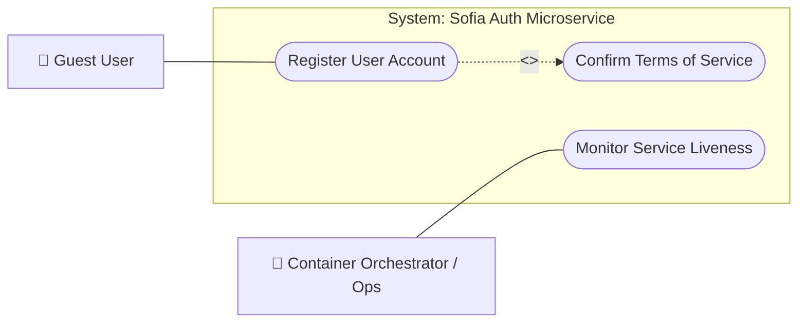

# Auth & Onboarding Use Cases

## 1. Overview
This document defines the functional perimeter and user-facing capabilities of the **Auth Microservice**, mapping how prospective members interact with account registration and legal terms acceptance within the Sofia platform.

---

## 2. Use Case Diagram

---

## 3. Specifications & Actor Capabilities

### 3.1 Actors
- **Guest User**: Unauthenticated visitor onboarding onto the Sofia platform by submitting email credentials and accepting platform terms.
- **Container Orchestrator / Ops**: Automated infrastructure probes monitoring microservice health and readiness.

### 3.2 Core Use Cases
- **Register User Account (`POST /api/v1/signup/user`)**: Allows a guest user to initiate account registration with a valid email, bounded password, and explicit terms confirmation.
- **Confirm Terms of Service**: Mandatory included step ensuring legal consent (`accept_terms`) accompanies registration requests.
- **Monitor Service Liveness**: Diagnostic health probe confirming service operational status.

---

## 4. Related Implementation Files
- [`controller.py`](file:///home/pedrovotf/Desktop/Projects/Nievo-Sofia/Code/Back-end/Auth/src/service/signup/controller.py)
- [`service.py`](file:///home/pedrovotf/Desktop/Projects/Nievo-Sofia/Code/Back-end/Auth/src/service/signup/service.py)
- [`request.py`](file:///home/pedrovotf/Desktop/Projects/Nievo-Sofia/Code/Back-end/Auth/src/service/signup/request.py)
- [`user.py` (Repository)](file:///home/pedrovotf/Desktop/Projects/Nievo-Sofia/Code/Back-end/Auth/src/repositories/user.py)
