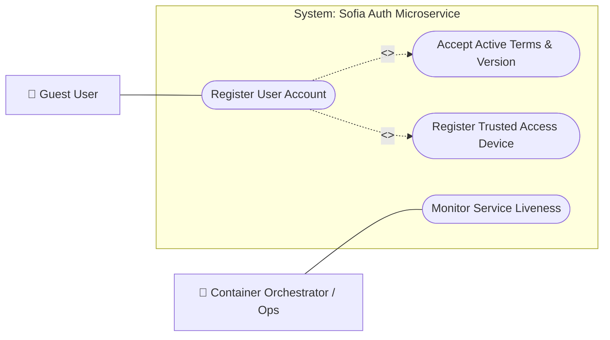

# Auth & Onboarding Use Cases

## 1. Overview
This document defines the functional perimeter and user-facing capabilities of the **Auth Microservice**, mapping how prospective members interact with account registration, active legal terms acceptance, and trusted client device registration within the Sofia platform.

---

## 2. Use Case Diagram

---

## 3. Specifications & Actor Capabilities

### 3.1 Actors
- **Guest User**: Unauthenticated visitor onboarding onto the Sofia platform by submitting nickname, email, compliant password credentials, device identification headers, and legal terms consent.
- **Container Orchestrator / Ops**: Automated infrastructure probes monitoring microservice health and readiness.

### 3.2 Core Use Cases
- **Register User Account (`POST /api/v1/signup/user`)**: Allows a guest user to create a new member account with a display nickname, unique email address, and complexity-validated password.
- **Accept Active Terms & Version**: Mandatory included capability verifying explicit legal consent (`accept_terms`) against an active platform terms version (`term_code` and `term_version`) and recording an auditable agreement in `signup.user_agreements`.
- **Register Trusted Access Device**: Mandatory included capability capturing the user's client device identifier (`X-Device-Id`), `User-Agent`, and origin IP address (`member.device`) upon account creation.
- **Monitor Service Liveness (`GET /health`)**: Diagnostic health probe confirming service operational status.

---

## 4. Related Implementation Files
- [`controller.py`](file:///home/pedrovotf/Desktop/Projects/Nievo-Sofia/Code/Back-end/Auth/src/service/signup/controller.py)
- [`service.py`](file:///home/pedrovotf/Desktop/Projects/Nievo-Sofia/Code/Back-end/Auth/src/service/signup/service.py)
- [`request.py`](file:///home/pedrovotf/Desktop/Projects/Nievo-Sofia/Code/Back-end/Auth/src/service/signup/request.py)
- [`encryption.py`](file:///home/pedrovotf/Desktop/Projects/Nievo-Sofia/Code/Back-end/Auth/src/core/encryption.py)
- [`user.py` (Repository)](file:///home/pedrovotf/Desktop/Projects/Nievo-Sofia/Code/Back-end/Auth/src/repositories/user.py)
- [`terms.py` (Repository)](file:///home/pedrovotf/Desktop/Projects/Nievo-Sofia/Code/Back-end/Auth/src/repositories/terms.py)
- [`user_agreements.py` (Repository)](file:///home/pedrovotf/Desktop/Projects/Nievo-Sofia/Code/Back-end/Auth/src/repositories/user_agreements.py)
- [`device.py` (Repository)](file:///home/pedrovotf/Desktop/Projects/Nievo-Sofia/Code/Back-end/Auth/src/repositories/device.py)
