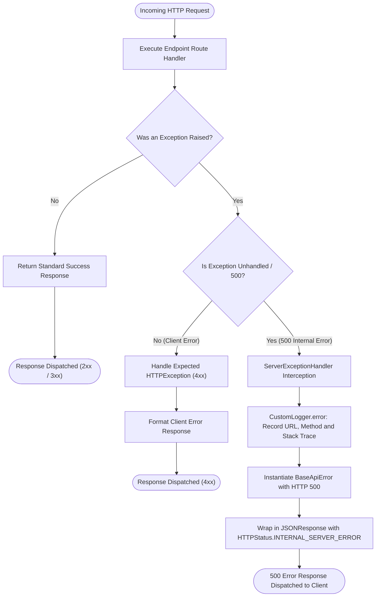

# Global Server Exception Handling Decision Flow

## 1. Overview
This policy defines how runtime exceptions, unhandled faults, and unexpected server failures are trapped, logged, and surfaced across the Sofia backend services to ensure consistent error envelope contracts and prevent raw stack traces from leaking to clients.

---

## 2. Decision Flowchart

The following Mermaid flowchart maps the evaluation gates and decision tree executed upon an incoming HTTP request encountering an exception:

---

## 3. Specifications & Evaluation Gates

### 3.1 Decision Gates

1. **Gate: Exception Interception**:
   - Condition: Does the execution of the route handler raise an unhandled exception inheriting from `Exception`?
   - Decision Path: If no, the response flows directly back to the caller. If yes, FastAPI's registered exception handler takes control.

2. **Gate: Error Classification**:
   - Condition: Is the error an unhandled runtime error (e.g., `ZeroDivisionError`, database connection drop, unhandled bug) or a client-side HTTP error (4xx)?
   - Policy: Unhandled errors are routed to `ServerExceptionHandler`, preventing standard Python tracebacks from leaking.

3. **Gate: Structured Serialization**:
   - Sanitization: Exception string details are encapsulated in `BaseApiError["data"]["details"]` only when `DEBUG` is enabled (`"True"`), preventing internal stack details from leaking in production.
   - Status Flag: Set to `"false"` indicating unsuccessful execution.
   - Logging: Audit log entry is written with `CustomLogger` at `ERROR` level.
   - Status Code: Explicitly returned with HTTP status code 500 (`INTERNAL_SERVER_ERROR`).

---

## 4. Related Implementation Files
- [`server_exception_handler.py`](file:///home/pedrovotf/Desktop/Projects/Nievo-Sofia/Code/Back-end/Auth/src/core/middleware/server_exception_handler.py)
- [`base_api_error.py`](file:///home/pedrovotf/Desktop/Projects/Nievo-Sofia/Code/Back-end/Auth/src/schema/default/base_api_error.py)
- [`logging.py`](file:///home/pedrovotf/Desktop/Projects/Nievo-Sofia/Code/Back-end/Auth/src/core/logging.py)
- [`main.py`](file:///home/pedrovotf/Desktop/Projects/Nievo-Sofia/Code/Back-end/Auth/src/main.py)
