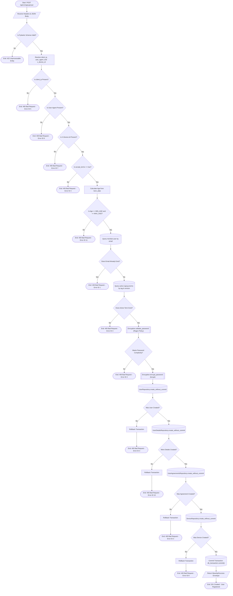

# User Signup Validation & Persistence Decision Flow

## 1. Overview
This policy defines the deterministic sequence of validation gates, security checks, and transactional persistence steps enforced by `SignupController` and `SignupService` during user onboarding (`POST /api/v1/signup/user`). Every registration request must pass client telemetry verification, explicit legal consent validation, age eligibility validation, email uniqueness checks, active terms verification, password complexity enforcement, and atomic four-stage relational persistence (`member.user`, `member.user_details`, `signup.user_agreements`, and `member.device`) with automatic rollback on any failure.

---

## 2. Decision Flowchart

The following Mermaid decision flowchart maps all conditional gates, domain error codes (`EResponseAuth`), transactional boundaries, and terminal HTTP outcomes:

---

## 3. Specifications & Policy Gates

### 3.1 Client Telemetry, Legal Consent & Age Gates
1. **Client IP Resolution & Gate (`Error ID 5`)**:
   - `SignupController` extracts the first IP from `X-Forwarded-For` when present, falling back to `request.client.host`.
   - If `client_ip` resolves to `None`, registration is rejected with `SIGNUP_400_SIGNUP_USER_IP_NOT_FOUND` (`5`).
2. **User-Agent Gate (`Error ID 6`)**:
   - Requires a non-null `User-Agent` HTTP header; otherwise rejects with `SIGNUP_400_SIGNUP_USER_USER_AGENT_NOT_FOUND` (`6`).
3. **Device Identifier Gate (`Error ID 7`)**:
   - Requires a non-null `X-Device-Id` HTTP header; otherwise rejects with `SIGNUP_400_SIGNUP_USER_DEVICE_ID_NOT_FOUND` (`7`).
4. **Terms Acceptance Gate (`Error ID 4`)**:
   - Requires `accept_terms is True`; otherwise rejects with `SIGNUP_400_SIGNUP_USER_TERMS_NOT_ACCEPTED` (`4`).
5. **Age Eligibility Gate (`Error ID 11`)**:
   - Parses `born_date` and calculates whole years elapsed. Verifies against configured boundaries (`MIN_AGE_FOR_ACCOUNT`, default `6` / configured `8`; `MAX_AGE_FOR_ACCOUNT`, default `110` / configured `90`). Rejects out-of-range dates with `SIGNUP_400_SIGNUP_USER_WITH_INVALID_BIRTH_DATE` (`11`).

### 3.2 Domain & Credential Security Gates
6. **Email Uniqueness Gate (`Error ID 1`)**:
   - Queries `UserRepository.get_by_mail(email)`. If an existing user record is found, rejects with `SIGNUP_400_SIGNUP_USER_USER_ALREADY_EXISTS` (`1`) using a generic message (`"Email or username invalid"`) to prevent account enumeration.
7. **Active Terms Lookup Gate (`Error ID 3`)**:
   - Queries `TermsRepository.get_by_tag_and_version(term_code, term_version)` filtering `active == True`. If no active record matches, rejects with `SIGNUP_400_SIGNUP_USER_TERM_INVALID` (`3`).
8. **Password Complexity Gate (`Error ID 2`)**:
   - Evaluates `Encryption.validate_password(password)` against `REGEX_FOR_PASSWORD` (requiring at least one digit `0-9`, one lowercase letter, one uppercase letter, one special character, no whitespace, and length between 8 and 16 characters). On failure, rejects with `SIGNUP_400_SIGNUP_USER_PASSWORD_INVALID` (`2`).

### 3.3 Atomic Transactional Persistence Gates
All database writes are executed under a single active transaction. Any write failure triggers an explicit `db_transaction.rollback()`.
9. **User Creation Gate (`Error ID 3`)**:
   - Persists `User` in `member.user` via `create_without_commit`. Rollbacks and returns `SIGNUP_400_SIGNUP_USER_NOT_CREATED_USER` (`3`) if persistence fails.
10. **User Details Creation Gate (`Error ID 10`)**:
    - Persists `UserDetails(user_id=new_user.id, born_date=request.born_date)` in `member.user_details` via `create_without_commit`. Rollbacks and returns `SIGNUP_400_SIGNUP_USER_NOT_CREATED_USER_DETAILS` (`10`) if persistence fails.
11. **Terms Agreement Audit Gate (`Error ID 3`)**:
    - Persists `UserAgreements(user_id=new_user.id, term_id=term.id)` in `signup.user_agreements` via `create_without_commit`. Rollbacks and returns `SIGNUP_400_SIGNUP_USER_NOT_CREATED_AGREEMENTS` (`3`) if persistence fails.
12. **Device Registration Gate (`Error ID 8`)**:
    - Persists `Device` in `member.device` via `create_without_commit`. Rollbacks and returns `SIGNUP_400_SIGNUP_USER_NOT_CREATED_DEVICE` (`8`) if persistence fails.
13. **Transaction Commit**:
    - Calls `db_transaction.commit()` and returns `201 Created` (`BaseApiSuccess`) with `SIGNUP_201_SIGNUP_USER_CREATED` (`9`).

---

## 4. Related Implementation Files
- [`controller.py`](../../../../Code/Back-end/Auth/src/service/signup/controller.py)
- [`service.py`](../../../../Code/Back-end/Auth/src/service/signup/service.py)
- [`request.py`](../../../../Code/Back-end/Auth/src/service/signup/request.py)
- [`encryption.py`](../../../../Code/Back-end/Auth/src/core/encryption.py)
- [`Eresponse_auth.py`](../../../../Code/Back-end/Auth/src/core/enum/Eresponse_auth.py)
- [`user.py` (Entity)](../../../../Code/Back-end/Auth/src/contracts/entities/user.py)
- [`user_details.py` (Entity)](../../../../Code/Back-end/Auth/src/contracts/entities/user_details.py)
- [`user.py` (Repository)](../../../../Code/Back-end/Auth/src/repositories/user.py)
- [`user_details.py` (Repository)](../../../../Code/Back-end/Auth/src/repositories/user_details.py)
- [`terms.py` (Repository)](../../../../Code/Back-end/Auth/src/repositories/terms.py)
- [`user_agreements.py` (Repository)](../../../../Code/Back-end/Auth/src/repositories/user_agreements.py)
- [`device.py` (Repository)](../../../../Code/Back-end/Auth/src/repositories/device.py)
